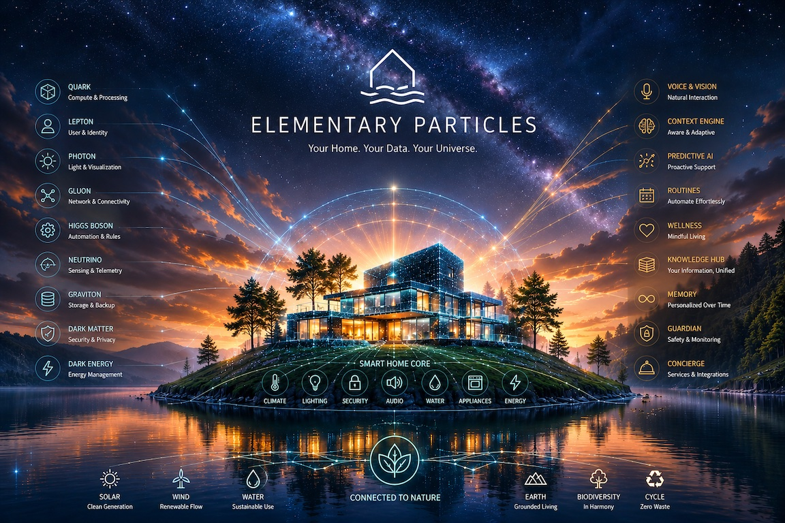

  

# Elementary Particles

A homelab run as code for with self-hosted AI concierge for the family, all on hardware you own, with no cloud service needed for daily use. AI accelerates the particles, but you steer the flow.

## Built with

[Proxmox VE](https://www.proxmox.com/en/products/proxmox-virtual-environment/overview) · [Terraform](https://www.terraform.io) ·
[Ansible](https://www.ansible.com) · [Vault](https://www.vaultproject.io) · [Traefik](https://traefik.io/traefik) ·
[Authelia](https://www.authelia.com) · [OPNsense](https://opnsense.org) · [PostgreSQL](https://www.postgresql.org) ·
[Prometheus](https://prometheus.io) · [Grafana](https://grafana.com) · [n8n](https://n8n.io) · [Forgejo](https://forgejo.org) ·
[Ollama](https://ollama.com) · [Whisper](https://github.com/openai/whisper)

Run for the family: [Nextcloud](https://nextcloud.com), [Immich](https://immich.app), [Jellyfin](https://jellyfin.org),
[Paperless-ngx](https://docs.paperless-ngx.com), [Home Assistant](https://www.home-assistant.io),
[Frigate](https://frigate.video), [Outline](https://www.getoutline.com), [Tandoor](https://tandoor.dev),
[Firefly III](https://www.firefly-iii.org) and [WGER](https://wger.de). Licenses are listed in [THIRD_PARTY.md](THIRD_PARTY.md).

## Why

Photos, music, the family calendars, contacts, health data, documents: I want them on hardware I own, under rules I set. Owning
your data also means guarding it, so security is built into how the system runs. And when the family depends on it, a homelab
becomes production. The longer story is in [why this exists](docs/guide/WHY.md).

## How it works

Everything is an Elementary Particle, a small unit with one job, described by its own `service.yaml`. Tags decide what gets exposed, how it logs in and
whether it is backed up. The rule for the AI is: **AI suggests, checks code, people decide.**

- [The philosophy](docs/guide/PHILOSOPHY.md): particles, tags, one source of truth
- [Agents and checks](docs/guide/AGENTS_AND_CHECKS.md): what the agents may and may not touch, and how pull requests are checked
- [A map of the repository](docs/guide/REPOSITORY_MAP.md)
- [Using it, with an example](docs/guide/USING.md): one change from request to running service
- [Deploying from scratch](docs/guide/DEPLOY.md): preflight, templates and the layers in order
- [Hardware and dependencies](docs/guide/REQUIREMENTS.md): what it takes to run it, from one host to three

This is the public, sanitized edition of a homelab that runs every day. Names, domains and credentials are replaced; the structure,
code and decisions are real. Claude Code was co-author of 447 of the 947 commits on the main branch
(67 % since it started in July 2026). I decide what gets built and I review and merge every change.
Measured results are in [agent metrics](docs/AGENT_METRICS.md).

## Known gaps

This is a homelab that is hardened in the open, not a finished product.

- **Some services trust the network.** The music studio API has no login of its own. Through the reverse proxy it sits behind single
  sign-on, but its direct port on the VM answers without one, so anyone who can reach that port on the home network can upload files,
  edit songs, start processing jobs and write to the songbook repository with a stored token. Per-port firewall rules are planned.
- **n8n webhooks have no authentication.** About ten webhook nodes in [`n8n/workflows/`](n8n/workflows) accept unauthenticated
  requests from the home network and the VPN, never from the internet. Header authentication is planned.
- **Agent sessions and the human share one Git identity today.** Agents never push to the main branch by rule. Giving them their
  own account so the host can enforce it is planned.
- **GitHub Actions only runs the CLA check.** The pipeline is a Forgejo Actions workflow in `.forgejo/` and does not run on GitHub.

## License

Copyright © 2026 Rob Carroll.
Licensed under the [GNU Affero General Public License v3.0](LICENSE) (AGPL-3.0-only).
If you run a modified version as a network service, you must offer its source to its users.

**Commercial licensing is available.** If the AGPL does not fit your use, for example you want to build
this into a proprietary product or run it as a closed service, a commercial license can be arranged with
the maintainer. Open an issue titled "Commercial license" (no details needed) and you will be contacted
privately. Consulting and help adapting this to your own setup are available the same way.

The name "Elementary Particles" is not licensed under the AGPL. Please do not use them in a way that suggests your fork is the original or is endorsed by the maintainer.

Contributions are welcome and need a signed Contributor License Agreement; see
[CONTRIBUTING.md](CONTRIBUTING.md).
