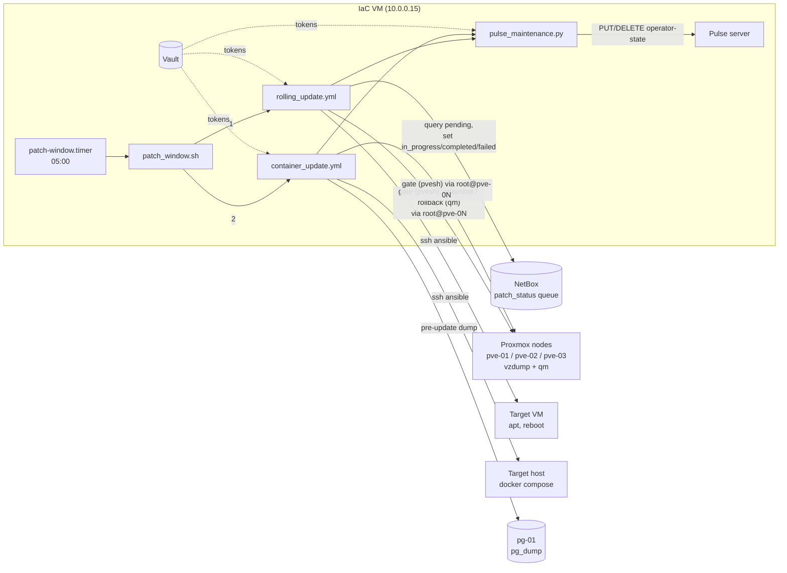
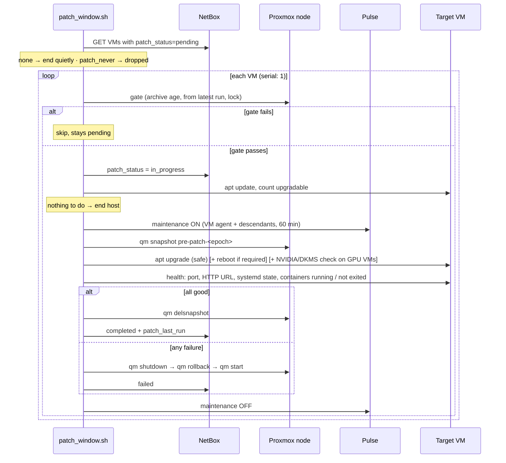
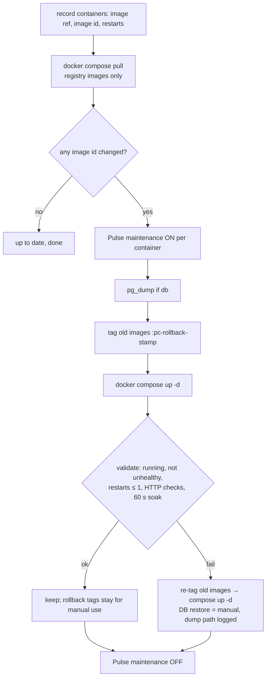

# Automated patching — architecture and flow

Status: **live since 2026-09-28** (first real window: Wed 2026-09-30 05:00 CEST).
Design background and decisions: `docs/BACKUP_PATCH_RESTORE_PLAN.md`. This document describes what is **built**.

## In one paragraph

Every morning at **05:00** a systemd timer on the IaC VM runs `patch_window.sh`. It patches **VMs** that are queued in
**NetBox** (`patch_status = pending`), then **containers** that are opted in per host in the Ansible inventory. Nothing is
touched unless **its own last backup is finished and recent** (Proxmox vzdump). Before any change, the target is put
into a **Pulse maintenance window** (alerts muted, visible on the dashboard) and protected: a **Proxmox snapshot** for a
VM, **rollback image tags plus a Postgres dump** for a container. After the change it is validated. On success the
protection is removed and NetBox is updated. On failure it is **rolled back automatically**, NetBox shows `failed`, and
the window is cleared so Pulse alerts show the real state.

## Components and what each one does

| Component | Where | Role in patching |
|---|---|---|
| **systemd timer** `patch-window.timer` | IaC VM, user `netops` (`systemctl --user`) | Fires 05:00 Europe/Berlin daily. `Persistent=false`: a missed window is skipped, never run late in the day. |
| **`scripts/patch_window.sh`** | IaC VM (`IaC/scripts/`) | Orchestrator: loads Vault env, pins ansible-core, runs the VM pass then the container pass, writes logs and a summary. |
| **`playbooks/rolling_update.yml`** | IaC VM | VM pass: queue → gate → snapshot → apt → health → commit / rollback. OS packages only. |
| **`playbooks/container_update.yml`** + `tasks/container_stack_update.yml` | IaC VM | Container pass ("patch-conductor" v1): per opt-in compose stack, pull → update → validate → rollback. |
| **`scripts/pulse_maintenance.py`** | IaC VM | Sets/clears Pulse maintenance windows for a host (agent + all its containers, or the VM) or one container. |
| **NetBox** | web-01, `netbox.home.example.org` | **The VM queue and its status.** Custom fields `patch_status`, `patch_last_run`, `proxmox_vm_id`, `proxmox_node`, `health_check_*`. |
| **Proxmox VE** | pve-01 / pve-02 / pve-03 | Source of truth for **backups** (vzdump archives + job runs) and the **snapshot/rollback** mechanism (`qm`). |
| **Pulse** | IaC VM, `pulse.home.example.org` | **Maintenance windows** (alert suppression + visibility), update detection for all containers, agents on 14 hosts. |
| **Vault** | IaC VM | Tokens: `secret/netbox/api`, `secret/pulse/patch-conductor` (monitoring:read/write). |
| **pg-01** | Storage VLAN | Pre-update `pg_dump` for DB-backed stacks (`/var/lib/postgresql/prepatch/`, newest 5 kept). |
| **n8n** | web-01 | Not in the patch path any more (see *Retired trigger path*). Still runs the zero-day warning and the daily orphaned-snapshot check. |

## Architecture



## Daily timeline (Europe/Berlin)

| Time | What | Relevance to patching |
|---|---|---|
| 03:00 | vzdump on **pve-01** (done ~04:35; 05:03-05:09 in the week of 2026-10-19) and **pve-03** (runs to ~06:40, one VM after another) | Creates the backups the gate requires. |
| **05:00** | **Patch window** | Saturdays first queue every `patchable_vms` VM (`pending`), then VMs/containers whose *own* backup from the latest run is finished. |
| **Sat 05:45** | **gpu-02 window** (`patch-window-gpu02.timer`) | Queues and patches only `gpu-02` (group `patchable_vms_gpu02`), see below. pve-03's vzdump ended 05:01-05:12 on 2026-11-01..05; if it still runs, the gate skips gpu-02 until next Saturday. |
| **Sun 06:00** | **Home Assistant window** (`patch-window-ha.timer`) | Queues and patches only `home-assistant` (group `patchable_vms_sunday`), see below. |
| 06:00 | vzdump on **pve-02** | pve-02 VMs are gated on the previous day's run until then. pve-02 powers off 07:00–23:00. |
| 07:30 UTC | nas-01 replication snapshot → 08:15 UTC pull to nas-02 | Independent (NAS VMs are never auto-patched). |

## The weekly queue (since 2026-10-16)

On `PATCH_QUEUE_WEEKDAYS` (`date +%u`, default `6` = Saturday) `patch_window.sh` runs
`netbox_setup_patch_fields.yml --tags seed_vms` (Proxmox VM id/node and health checks from the
inventory into NetBox) and then `--tags reset_pending`: every host in the inventory group
`patchable_vms` is `pending`. The same window drains the queue; a VM that is off, fails its
gate or fails its pre-check stays `pending` and is retried each morning until it succeeds.
Before this, nothing filled the queue: in two months three VMs were patched, by hand-queueing.

`patchable_vms` was rebuilt the same day from the live VM list (19 VMs). `patch_never` still wins.

## Home Assistant's own slot (since 2026-10-23)

`home-assistant` (VM 282, pve-01) is not in `patchable_vms` and not in `patch_never`. Its
backup lands ~05:02, so the 05:00 window's gate would skip it every day. Instead:

- `patch-window-ha.timer` (Sunday 06:00) runs `patch_window.sh` with `PATCH_QUEUE_WEEKDAYS=7`,
  `PATCH_QUEUE_GROUP=patchable_vms_sunday`, `PATCH_HOST=home-assistant`, `PATCH_SKIP_CONTAINERS=1`:
  queue the group, then the normal VM pass (gate, snapshot, apt, reboot if needed, health
  check, rollback) for that one host. Units: `scripts/systemd/patch-window-ha.{timer,service}`.
- `rolling_update.yml` skips every `patchable_vms_sunday` host unless `patch_host` names it, so
  the daily window never patches HA on a weekday, even if it is left `pending`.
- HA's host vars raise the post-patch health check to 36 x 10 s: Core needs 2-4 min after a reboot.
- What it patches: the Debian host (apt, Docker, kernel). HA Core, Supervisor and add-ons are
  updated by Supervisor, not by this pipeline.

## gpu-02's own slot (since 2026-11-05)

`gpu-02` (VM 211, pve-03, RTX 2070 passthrough) runs DOMO voice (gateway, Whisper), the DOMO
classifier, HA speech-to-text and immich-ml. In the daily window it went down twice
(2026-10-26 and 2026-11-03, for days each time):
1. the apt upgrade installed a new NVIDIA userland; with the old module still loaded,
   `nvidia-smi` failed with "Driver/library version mismatch";
2. the remediation (headers + DKMS) can't fix that, so the rescue rolled the VM back;
3. `qm start` after the rollback timed out: the VM pins its 10 GB at start, and pve-03's vzdump
   was still running.

Since 2026-11-05:
- `patch-window-gpu02.timer` (**Saturday 05:45**) runs `patch_window.sh` with
  `PATCH_QUEUE_WEEKDAYS=6`, `PATCH_QUEUE_GROUP=patchable_vms_gpu02`, `PATCH_HOST=gpu-02`,
  `PATCH_SKIP_CONTAINERS=1`. After pve-03's vzdump and the daily window, done before DOMO's 06:30
  brief. Both timers and pve-03's vzdump are Europe/Berlin, so DST moves them together.
  Units: `scripts/systemd/patch-window-gpu02.{timer,service}`.
- `rolling_update.yml` skips every host in `patch_own_slot_groups` (group_vars/all.yml:
  `patchable_vms_sunday`, `patchable_vms_gpu02`) unless `patch_host` names it.
- Phase 3f **reboots** on "Driver/library version mismatch" and checks again; the DKMS
  remediation and the rollback only run if the GPU still fails after that.
- The rescue starts a rolled-back VM with `qm start --timeout 300`.

pve-03's memory (2026-11-05): gpu-02 10 GB, web-02 4.5, nas-02 4, media-vm 3, immich-01 2.5,
studio-01 2 (+3 GB swap file) = 26 GB of 31 GiB, with a 2 GiB ARC: all six run together,
~3 GB left.

## Before anything changes on a VM (since 2026-10-16)

1. **Reachable?** An unreachable VM (pve-02 is off 07:00–23:00) is skipped and stays pending. With
   `serial: 1` Ansible used to end the whole play at the first unreachable VM.
2. **Health check passes on the unpatched VM?** If not, the check is wrong (web-02 still checked
   Jira on :8080): the VM is skipped with a message, not patched and then rolled back. A rollback
   discards everything written since the snapshot.

## The backup gate (both passes)

Evaluated per target VM on its Proxmox node (`pvesh`, as root via the inventory alias `pve-01/02/03`):

1. **Newest vzdump archive of this VM** on `nfs-backups` exists and is **< 26 h old** (`patch_backup_max_age_hours`).
2. That archive was written **during the node's latest vzdump run** (archive ctime ≥ start of the most recent job).
   This means "this VM's backup is finished", even if the job is still backing up other VMs.
3. The VM is **not locked** (it is locked while being backed up or snapshotted).

Fail → the VM/host is skipped and **stays `pending`**; the next window retries it. The rule is per VM on purpose:
pve-03's job runs until ~06:40, so a node-wide "no backup running" rule would block every pve-03 VM at 05:00 forever.

## VM pass — `rolling_update.yml`



- **OS only** (`rolling_update_docker: false`). Containers are the container pass's job, so a failure is attributable.
- **Never auto-patched** (`patch_never`): `iac-vm`, `fw-01`, `home-assistant`, `nas-01`, `nas-02`, `mail-agent-01`.
  The IaC VM would be rolling back the machine running the rollback; fw-01/HA have their own updaters; the NAS VMs have
  raw passthrough disks (`qm snapshot` can't cover them).

## Container pass — `container_update.yml`

Only stacks listed in a host's inventory entry are touched:

```yaml
# inventory/services.yml, under the host
container_patch_stacks:
  - name: tandoor
    dir: /opt/tandoor                 # compose project directory
    health: ["http://localhost:8095/"] # 2xx/3xx/401 = up
    db: tandoor                       # optional: pg_dump on pg-01 first
```

Per host: gate → per stack:



Opt-in today: **web-01 `homepage`** (pinned tag → normally a no-op) and **web-02 `tandoor`** (`:latest`, with DB dump).

Version bumps of pinned tags run through the same pass (2026-10-16), stack by stack:
`images: {old_ref: new_ref}`, `backup_files` (files/dirs the new version migrates; SQLite via online
backup; `stop_for_backup`), `ready_retries`/`http_retries`, and health checks that must pass on the
current version first. Ad hoc: `container_update.yml --limit HOST -e @stack.json`. Used for Traefik,
n8n, Paperless, Authelia, Frigate and Jellyfin on 2026-10-16.
Not listed: locally built images (e.g. `hometown-news`: updated by rebuilding) and Home Assistant add-ons (HAOS owns them).
Everything else Pulse flags as "update available" is **report-only** by design.

**Immich (pinned, report-only — 2026-10-20).** `immich_version` in `inventory/group_vars/all.yml` is the one pin for
both immich-server (immich-01, compose) and immich-ml (gpu-02, `docker run` via `Roles/gpu/tasks/immich_ml.yml`); the
two must always run the same version. Until 2026-10-20 both used the moving `release` tag, so whichever host happened to
pull last drifted (server v3.1.0, ML v3.2.2). Immich is deliberately **not** in `container_patch_stacks`: its releases
run DB migrations (no automatic rollback once they have run) and sometimes need manual steps, so nothing upgrades it
unattended. A bump is: read the release notes from the running version up to the target → `pg_dump immich` on pg-01 →
change `immich_version` → `deploy_immich.yml` (immich-01) + the gpu role's `immich_ml` tasks (gpu-02) → check the
version endpoint, logs and job queues. The OS of both VMs is still patched in the normal window; only the containers wait.

## Status model (NetBox `patch_status`)

| Value | Meaning | Set by |
|---|---|---|
| *(empty)* | Not queued | — |
| `pending` | **Queued for the next window** | You (NetBox UI/API) or a future scheduler |
| `in_progress` | Window is working on it | `rolling_update.yml` |
| `completed` | Patched and validated; `patch_last_run` = date | `rolling_update.yml` |
| `failed` | Rolled back to the pre-patch snapshot | `rolling_update.yml` |

The built-in NetBox VM `status` stays `active` throughout (user decision 2026-09-26).

## Retired trigger path (why n8n is not in the loop)

Before 2026-09-28: NetBox event rule **"EP Patch Trigger"** → n8n **"EP: NetBox Patch Trigger → rolling_update.yml"** →
iac-api → an immediate real run for that one VM. It fired on **any update** to a VM that was `pending`, and 12 VMs had sat
on `pending` since August. Both are **disabled**; the flags were cleared. `pending` now means "candidate for the next
window", which is the intended model. Parallel webhook-triggered runs also couldn't guarantee one VM at a time.

## Operating it

```bash
# Queue a VM: NetBox UI → VM → Custom fields → Patch Status = Pending (or the API)

# Dry run of the full window (queue, gates, detection; changes nothing, doesn't touch NetBox)
PATCH_DRY_RUN=1 ~/GitLab/GitOps/scripts/patch_window.sh
# ...exactly as the timer runs it (same minimal environment):
systemd-run --user --wait --collect -p Environment=PATCH_DRY_RUN=1 \
  ~/GitLab/GitOps/scripts/patch_window.sh

# Results
ls -t ~/patch-logs/ | head            # <date>_<time>-{summary,vms,containers}.log, kept 60 days
systemctl --user list-timers patch-window.timer

# Skip tomorrow / disable
systemctl --user stop patch-window.timer        # until next login/reboot of the unit
systemctl --user disable --now patch-window.timer

# Maintenance window by hand
IaC/scripts/pulse_maintenance.py set web-02 --minutes 30 --reason "manual work"
IaC/scripts/pulse_maintenance.py clear web-02
```

Adding a container stack: add it to `container_patch_stacks` for its host, then dry-run.

## Lessons baked in (read before changing things)

- **Pin the toolchain for timers.** systemd `--user` has no `~/.local/bin` in `PATH`; the first real window ran
  Debian's ansible 2.10 and died on unknown modules. `patch_window.sh` uses `~/.local/bin/ansible-playbook` and refuses
  ansible-core < 2.15. Test timers **through systemd**, not only from an interactive shell.
- **Delegate to inventory aliases, not node names.** `qm`/`pvesh` run on `pve-01/02/03` as root (`become: false`, no sudo
  on PVE). Delegating to `pve-01` never resolved; the snapshot step had never actually run before 2026-09-28.
- **Dry runs must be side-effect free.** A dry run once set git-01 to `in_progress` and would have emptied the queue.
- **Per-VM gate, not per node** (see above).
- **`.env` parsing:** `/opt/vault/.env` values are single-quoted; never `source` it (it mangles `$ ! \``). The wrapper reads
  only the four keys it needs, byte-exact.
- **Pulse is monitoring, never a blocker:** maintenance calls use `ignore_errors`. A host without a Pulse agent falls
  back to its Proxmox VM resource.

## Not built yet

- Waves (canaries → apps → core) instead of one weekly queue of everything.
- Result notification (Matrix via the existing n8n alert path); NetBox journal entries per container update.
- Automatic DB restore after a failed container update (deliberately manual for now).
- Real version bumps for pinned tags (repo change, e.g. Renovate on Forgejo).
