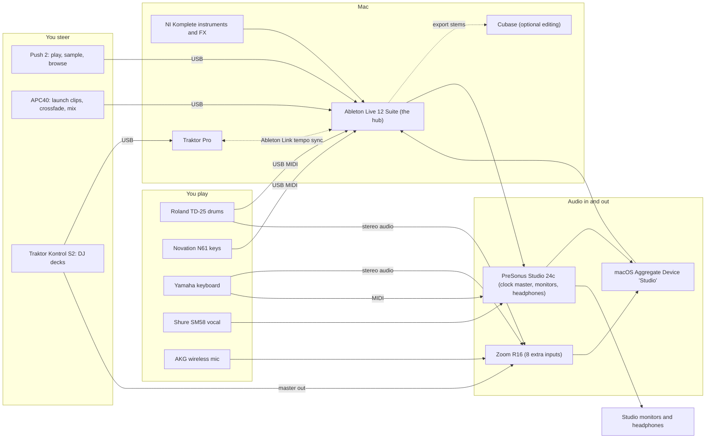
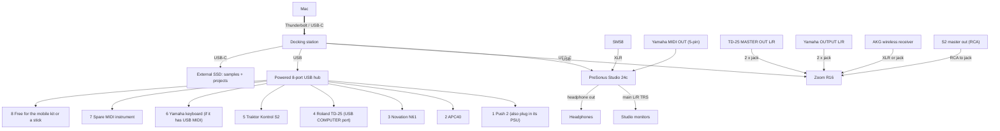

# Studio Dream Machine – Setup & Ableton Training Plan

Oct 26, 2026 · @R&R

## Overview: one hub, capture everything

Make Ableton Live 12 Suite the single home for every idea, and make it always ready to record. Every other piece of gear either plays into Live, gets sound into Live, or (Traktor) syncs with Live. For an ADHD brain the rule is simple: the gap between "idea" and "it is recorded" should be one button.

Three principles drive every choice below:

1. **Zero setup time.** One default template opens with drums, keys, vocals and a sampler already armed. You never wire anything mid-idea.
2. **Capture first, judge later.** Live's Capture MIDI and a looper mean nothing you play is lost, even if you never pressed record.
3. **Session View for chasing ideas, Arrangement View for finishing them.** Mashups and song-into-song flow live in Session View; the timeline comes later.

| Gear | Role in the studio |
| --- | --- |
| Ableton Live 12 Suite | Main hub: jamming, sampling, mashups, recording, arranging |
| Push 2 | Main hands-on instrument for Live: play, sample, browse, mix without the mouse |
| APC40 | Clip launcher and mixer for mashups and live sets |
| Novation N61 | Main keyboard for melodies, chords and synth control |
| Yamaha keyboard | Second keyboard, and a sound source of its own |
| Roland TD-25 | Drums: sends MIDI and audio to Live over one USB cable |
| PreSonus Studio 24c | Main audio interface: two mic inputs, monitors, headphones, MIDI |
| M-Audio R16/24 | Second interface or spare for extra inputs (see Mac setup) |
| Shure SM58 | Main vocal mic, wired |
| AKG wireless mic | Vocals while drumming, freedom to move |
| NI Komplete | Instruments and effects loaded inside Live (Kontakt, Massive, etc.) |
| Cubase 12 | Optional second DAW for detailed vocal editing and mixing |
| Reason 4 | Retire it on a modern Mac (see Mac setup) |
| Traktor + Kontrol S2 | Relaxed DJ mode, synced to Live with Ableton Link |

## Big picture: how the dots connect

Everything flows toward Ableton Live. Controllers send MIDI in, instruments and mics send audio in, and Traktor runs alongside, locked to Live's tempo through Ableton Link.

Read it left to right: you play or steer, the audio interfaces collect the sound, Live records and mixes it, and the 24c sends it to your speakers.

## Physical connections: port by port

Plug both audio interfaces straight into the dock, never into the hub, and put every controller on a **powered** 8-port hub. Audio interfaces hate sharing bandwidth and power; controllers do not mind.

I am assuming your "M-Audio R16/24" is the [Zoom R16 (or R24)](https://www.hhb.co.uk/prod/zoom/r16/): an 8-in, 2-out USB interface and recorder. If it is a different box, tell me and I will redo this section.

| Source | Cable | Goes into | Live input |
| --- | --- | --- | --- |
| Shure SM58 | XLR | 24c input 1 | 1 |
| Spare mic, guitar, bass | XLR or jack | 24c input 2 | 2 |
| TD-25 master out L/R | 2 x 6.3 mm jack | R16 inputs 1-2 | 3-4 |
| Yamaha keyboard out L/R | 2 x 6.3 mm jack | R16 inputs 3-4 | 5-6 |
| AKG wireless receiver | XLR or jack | R16 input 5 | 7 |
| Spare line source | jack | R16 input 6 | 8 |
| Traktor S2 master out | RCA to 2 x jack | R16 inputs 7-8 | 9-10 |
| Studio monitors | 2 x balanced TRS | 24c main outs | outputs 1-2 |
| Headphones | 6.3 mm | 24c headphone out | outputs 1-2 |

The TD-25 goes in twice on purpose: USB carries the MIDI notes (so you can swap drum sounds later) and the audio cables carry the real Roland kit sound. The TD-25's USB port also supports [USB audio as well as MIDI](https://www.roland.com/au/products/td-25/media/), so on the mobile rig you can skip the cables entirely.

Power tips: give Push 2 its own power supply (it dims without it), and switch everything on before opening Live so it finds every device.

## Mac and software setup

Combine the 24c and R16 into one "Studio" Aggregate Device so Live sees 10 inputs, and keep Live as the only app you open for creating. Check one thing before any macOS update: Cubase 12 is not on Steinberg's list for macOS 26 Tahoe, while Live 12 is supported through Tahoe.

### Compatibility check

| Software or gear | Status on a current Mac | What to do |
| --- | --- | --- |
| Ableton Live 12 Suite | [Supported from macOS 11 through macOS 26 Tahoe, native on Apple silicon](https://help.ableton.com/hc/articles/115001261150) | Your main hub. Keep it updated. |
| Cubase 12 | Not listed by Steinberg for Tahoe; only [Cubase 14 and 15](https://www.steinberg.help/r/macos-tahoe-steinberg-product-compatibility) appear | Stay on macOS 15 Sequoia if you want Cubase 12, or treat it as optional |
| Reason 4 | [Reason 10.4.1 and earlier do not run on Apple silicon](https://help.reasonstudios.com/hc/en-us/articles/360017437959) | Retire it. Live Suite covers the same ground. |
| Zoom R16 | [Supported on Sonoma with the latest driver](https://zoomcorp.com/en/de/news/macos_sonoma/); [driver 1.5.0 added Apple silicon](https://zoomcorp.com/documents/3369/R16_R24_Driver_Mac_Version_History_ver170_en.pdf) | Install the newest Zoom R16/R24 driver first |
| PreSonus Studio 24c | Class-compliant 2-in/2-out with MIDI I/O | Install Universal Control for firmware updates |
| Traktor Kontrol S2 | [MK1 models stop working after macOS 10.14 Mojave](https://community.native-instruments.com/discussion/8066/what-is-the-sweet-spot-for-using-traktor-pro-3-and-kontrol-s4-mk1-on-a-macos); MK3 [works with Traktor Pro 4](https://www.native-instruments.com/products/traktorkontrols2mk3) | Yours is the MK3: nothing to do, it runs on Traktor Pro 4 and current macOS |
| NI Komplete | Installs through Native Access | Install only what you use; store libraries on the external SSD |

### Build the Aggregate Device (10 minutes, once)

1. Open **Audio MIDI Setup** (Applications > Utilities).
2. Click **+** at the bottom left and choose **Create Aggregate Device**. Rename it **Studio**.
3. Tick the **Studio 24c first**, then the **Zoom R16**. The first one becomes the clock source.
4. Tick **Drift Correction** on the R16 row only.
5. Set the sample rate to **48 kHz** on both devices.

### Live preferences (Settings > Audio and Link, Tempo & MIDI)

- **Audio input and output device:** Studio (fixed rig) or Studio 24c (mobile rig).
- **Buffer size:** 128 samples while recording, 512 while mixing.
- **Input config:** enable mono inputs 1-2, 7-8 and stereo pairs 3/4, 5/6, 9/10. Rename them (SM58, Drums, Yamaha, AKG, Traktor) so tracks show real names.
- **Control Surfaces:** slot 1 Push2, slot 2 APC40 (or APC40 mkII). Live sets these up itself when the devices are plugged in.
- **MIDI ports:** turn **Track** on for N61, TD-25, Yamaha, and **Remote** on for N61 so its knobs can map to anything.
- **Link:** tick **Show Link Toggle**.
- **Library:** put the User Library on the external SSD so the mobile Mac can use the same sounds.

### Your default template (the most important 15 minutes)

Build one Live Set and save it with **File > Save Live Set as Default Set**. Every new idea then opens ready to go:

| Track | Type | Input | Ready state |
| --- | --- | --- | --- |
| Drums MIDI | MIDI + Drum Rack | TD-25 | Armed, monitor Auto |
| Drums Audio | Audio | Drums (3/4) | Armed |
| Keys | MIDI + Komplete or Live instrument | N61 | Armed |
| Yamaha | Audio | Yamaha (5/6) | Armed |
| Vocal | Audio + EQ, compressor, reverb send | SM58 (1) | Armed |
| Wireless vocal | Audio | AKG (7) | Monitor In |
| Sampler | MIDI + Simpler | Push 2 | Ready to drag any sound onto |
| Looper | Audio + Looper device | Any input | For jamming without a grid |
| Traktor | Audio | Traktor (9/10) | Monitor In, for recording DJ sets |
| Return A / B | Reverb / Delay |  |  |

Turn on **Settings > Record, Warp & Launch > Start Recording on Scene Launch**. Color-code the tracks (drums red, keys blue, vocals yellow) so your eyes find things before your brain has to.

## Fixed studio vs mobile rig

The dock is the switch: unplug one cable and the Mac is mobile; plug it back in and the whole studio wakes up. The mobile rig runs on the bus-powered 24c alone, so it needs no power sockets except the laptop's.

|  | Fixed studio | Mobile rig |
| --- | --- | --- |
| Audio device in Live | Studio (24c + R16 aggregate) | Studio 24c only |
| Inputs | 10 | 2 (SM58 + one instrument or the AKG) |
| Controllers | Push 2, APC40, N61, Yamaha, TD-25 | Push 2 **or** APC40, plus one small MIDI keyboard |
| Drums | TD-25 with audio + MIDI | TD-25 over USB alone, or finger drumming on Push 2 |
| Speakers | Studio monitors | Headphones |
| Projects and samples | External SSD | Same external SSD |
| Power | Mains for Push 2, hub, monitors | Push 2 runs dimmer on USB power; carry its PSU if you can |

**Mobile bag checklist**

- [ ] Mac + charger
- [ ] Studio 24c + both its USB cables (C-to-C and C-to-A)
- [ ] External SSD
- [ ] Push 2 + PSU (or APC40)
- [ ] One small MIDI keyboard
- [ ] SM58 + XLR cable
- [ ] Closed headphones
- [ ] Small 4-port USB hub

To switch rigs, change only one setting in Live: **Settings > Audio > Audio Device**. Everything in your template keeps working; the tracks whose inputs are missing just stay silent.

The R16 also works on its own as a battery-powered 8-track recorder. Take it to a rehearsal, record to its SD card, and drag the WAV files into Live later.

## Traktor Kontrol S2 MK3: relaxed DJ mode

Use the S2 for Traktor and the APC40 for mixing inside Live. The S2 has its own sound card, so it can run as a self-contained DJ rig, and Ableton Link keeps Traktor and Live at the same tempo when you want both. Traktor Pro 4 [syncs with Live over Link](https://www.andertons.co.uk/native-instruments-traktor-pro-4-esd).

Your S2 is an MK3: it runs on USB bus power alone (no power supply needed), so keep it on the powered hub. Its built-in sound card shows up on the Mac as **Traktor Kontrol S2 MK3**.

**Mode 1: just DJ (couch mode)**

1. Plug the S2 into the hub, headphones into the S2, and speakers into the S2's master out.
2. In Traktor: **Preferences > Audio Setup > Audio Device: Traktor Kontrol S2 MK3**.
3. Play. Live stays closed.

**Mode 2: DJ + Live jam (hybrid)**

1. S2 master out goes into R16 inputs 7-8 (already wired above).
2. Open Live first, then Traktor. Turn on **Link** in both: in Live the Link button sits top left; in Traktor it is in the header.
3. In Traktor, set the Master Clock to Link and the deck sync mode to **BeatSync** for tight phase lock.
4. In Live, the Traktor track (inputs 9/10) is set to Monitor In. Arm it and press Record: your whole DJ set lands in Live's timeline.
5. Launch loops, drums or live keys in Live on top of the DJ mix. Everything stays on beat.

If the beats ever drift out of phase, use **Master Clock > Ableton Link > Reset Downbeat** in Traktor ([how-to](https://ask.audio/articles/how-to-sync-ni-traktor-and-ableton-live)).

**Mashup DJing inside Live instead**

The APC40 has a crossfader that Live understands. Assign tracks to side A or B (the A/B buttons under each track on the APC40), and you can blend whole songs in Session View the way you would on the S2, with Live's warping keeping them in time. This is the best route for flowing one song into another while you also play instruments.

## Ableton training: six short sessions

Six sessions of about 45 minutes, each with one goal and one thing you keep at the end. Do one per day or one per week; never two in a row. Tick them off as you go, and come back to me after each one with questions.

### Session 1: Find your way around

**Goal:** stop feeling lost. **You keep:** your first captured idea.

1. Press **Tab** to flip between Session View (grid of clips, for jamming) and Arrangement View (timeline, for finishing). That is the whole secret of Live: two views of the same song.
2. Open the Browser (**Cmd+Alt+B**). Drag any instrument from Sounds onto the Keys track.
3. Play the N61 for two minutes without recording anything.
4. Press **Capture MIDI** (the icon next to the record button, or **Cmd+Shift+C**). Live turns what you just played into a clip. Nothing you play is ever lost.
5. Press **Shift+?** to open the Info View: it explains whatever your mouse is over. Leave it on all week.

- [ ] Session 1 done

### Session 2: Drums and the loop

**Goal:** record a groove you can build on. **You keep:** a 4- or 8-bar drum clip.

1. Turn the metronome on and set the tempo (tap it in with **Tap**).
2. Set the global quantize (top bar) to **1 Bar** so clips start on the beat.
3. Click an empty slot on Drums MIDI and play the TD-25. The clip records and loops.
4. Turn on **MIDI Arrangement Overdub** (the + button) and add a fill on the next pass.
5. Open the clip, select all, press **Cmd+U** to quantize. Then undo and compare.
6. Repeat on Push 2's 64 pads: press **Note** mode with a Drum Rack selected.

- [ ] Session 2 done

### Session 3: Layer it up

**Goal:** turn one loop into a song idea. **You keep:** one scene with four clips playing together.

1. Load a Komplete instrument (Kontakt, Massive, etc.) on Keys and record a bass line or chords over the drums.
2. Record a Yamaha part as audio on the Yamaha track.
3. Record a vocal on the SM58 track. Sing badly; this is a sketch.
4. Click the scene number on the right to launch the whole row at once. That row is a song section.
5. Try the **Looper** device on the wireless-vocal track: tap to record, tap to overdub, no grid needed.

- [ ] Session 3 done

### Session 4: Sampling and mashups

**Goal:** mash two songs together. **You keep:** a working mashup scene.

1. Drag two songs from Finder into empty audio tracks in Session View. Live warps them to your tempo.
2. Open each clip: check the warp markers sit on the beat, set Warp mode to **Complex Pro** for full songs and **Beats** for drums.
3. Use the clip's **Transpose** knob to match keys. Live 12's scale awareness shows the key in the clip.
4. Right-click a drum loop and choose **Slice to New MIDI Track** to play it from the pads.
5. On Push 2, select a short audio clip and press **Convert** to turn it into a Simpler instrument you play chromatically on the pads.
6. Assign song A to crossfader side A and song B to side B on the APC40, then fade between them.

- [ ] Session 4 done

### Session 5: From jam to timeline

**Goal:** turn Session View ideas into a full track. **You keep:** a 3-minute arrangement.

1. In Session View, press the global **Arrangement Record** button (the dot in the transport).
2. Launch scenes, mute tracks, ride the APC40 faders. Live records your performance into the timeline.
3. Press **Tab**. Your jam is now a song on the timeline.
4. Cut, copy and move sections. **Cmd+E** splits a clip; **Cmd+D** duplicates a section.
5. Record three vocal takes over the chorus; Live stacks them in **take lanes**. Pick the best phrases by clicking them.
6. Flow one song into another: put the next song's scene right after, and crossfade with automation.

- [ ] Session 5 done

### Session 6: Mix and export

**Goal:** finish something. **You keep:** a WAV you can play to a friend.

1. Set every track's level so the loudest peak sits around -6 dB on the master.
2. Add EQ Eight to clean low rumble off vocals and keys (cut below 100 Hz).
3. Send vocals and keys to Return A (reverb) and B (delay) with the send knobs.
4. Put **Glue Compressor** on the master with gentle settings.
5. **File > Export Audio/Video.** Export the master, and tick **All Individual Tracks** if you want to finish the mix in Cubase.

- [ ] Session 6 done

## Recording session series

After the training, run these six recording sessions to build instinct. Each one uses the default template, lasts 30 to 60 minutes, and ends when the "done when" line is true, not when it is perfect.

| # | Session | Gear | Done when |
| --- | --- | --- | --- |
| 1 | Idea dump | N61, Push 2 | 10 clips saved, none finished |
| 2 | Drum takes | TD-25, metronome | 3 full drum takes recorded in Arrangement |
| 3 | Sing while drumming | TD-25 + AKG wireless | One verse and chorus with drums and vocal together |
| 4 | One-person band | Looper, Yamaha, N61, SM58 | 4 layered parts built live without stopping |
| 5 | Mashup flow | APC40, two or three songs | 5 minutes flowing from song A to B to C |
| 6 | Hybrid DJ set | S2 + Traktor, Push 2, Live via Link | 20-minute set recorded into Live |

**How every recording session runs**

1. **Warm up, 5 min:** play with nothing recording except Capture MIDI.
2. **Record, 25 to 40 min:** keep the record button on. Never stop to fix a mistake; play the next take.
3. **Mark, 5 min:** color the best clips green and add a locator (**Create > Add Locator**) at the best moments.
4. **Save, 2 min:** **File > Save Live Set As** with the date and one word (2026-10-27 drumsfire). Use **Collect All and Save** so samples travel with the project.

**Session 3 tip:** clip the AKG mic on a stand near the drum throne, and turn the TD-25 down in your headphone mix so the vocal is clear. Set the vocal track to monitor **In** so you hear yourself with no delay.

**Session 5 tip:** build one scene per song, with a bridge scene between songs holding the next song's intro loop. Launch the bridge, ride the crossfader, then launch the next song. Record it to Arrangement so the flow becomes a finished mix.

## Habits, cheat sheet and shopping list

The studio works best for a fast, jumping mind when finishing is never the goal of a single sitting. Catch ideas daily, finish weekly.

**Habits that suit an ADHD brain**

- **One app on screen.** Quit Mail, browsers and messages before opening Live. Turn on a macOS Focus mode called Studio.
- **The idea inbox.** Every new spark goes into a Live Set called INBOX as one clip. Never judge it the same day.
- **Timer sessions.** 25 minutes on, 5 off. When the timer rings mid-flow, ignore it; it is only there to start you.
- **Leave a breadcrumb.** End each session by writing one line in the clip name of what to try next.
- **Friday finish.** Once a week, pick one INBOX idea and push it through Sessions 5 and 6 of the training.
- **Hands, not mouse.** The more you do on Push 2 and the APC40, the less you get pulled into menus.

**Cheat sheet**

| Do this | Press |
| --- | --- |
| Switch Session / Arrangement | Tab |
| Capture what you just played | Cmd+Shift+C |
| Show or hide Browser | Cmd+Alt+B |
| Info View (explains anything) | Shift+? |
| Quantize | Cmd+U |
| Duplicate | Cmd+D |
| Split clip | Cmd+E |
| New MIDI track / audio track | Cmd+Shift+T / Cmd+T |
| Start and stop | Space |
| Undo | Cmd+Z |

**Shopping list (only what fills a gap)**

| Item | Why |
| --- | --- |
| Powered USB hub, if yours is unpowered | Push 2, APC40 and the TD-25 together can starve an unpowered hub |
| External SSD, 1 to 2 TB | Shared library and projects for fixed and mobile rigs |
| 4 x 6.3 mm jack cables, 1 x RCA to dual jack | TD-25, Yamaha and S2 into the R16 |
| Short USB-B and USB-C cables | Tidy runs from hub to controllers |
| Small 4-port hub | Mobile bag |
| Traktor Pro 4 upgrade | Only if you are still on an older Traktor (your MK3 is fully supported in Pro 4) |

## Sources

- [Ableton Mac compatibility guide](https://help.ableton.com/hc/articles/115001261150)
- [Steinberg macOS Tahoe compatibility](https://www.steinberg.help/r/macos-tahoe-steinberg-product-compatibility)
- [Reason Studios Apple silicon statement](https://help.reasonstudios.com/hc/en-us/articles/360017437959)
- [Zoom macOS Sonoma compatibility](https://zoomcorp.com/en/de/news/macos_sonoma/)
- [Zoom R16/R24 Mac driver history](https://zoomcorp.com/documents/3369/R16_R24_Driver_Mac_Version_History_ver170_en.pdf)
- [Roland TD-25 specs](https://www.roland.com/au/products/td-25/media/)
- [Native Instruments Traktor Kontrol S2](https://www.native-instruments.com/products/traktorkontrols2mk3)
- [NI community on S2/S4 MK1 and macOS](https://community.native-instruments.com/discussion/8066/what-is-the-sweet-spot-for-using-traktor-pro-3-and-kontrol-s4-mk1-on-a-macos)
- [Traktor Pro 4 and Ableton Link](https://www.andertons.co.uk/native-instruments-traktor-pro-4-esd)
- [Syncing Traktor and Live](https://ask.audio/articles/how-to-sync-ni-traktor-and-ableton-live)
- [Zoom R16 overview](https://www.hhb.co.uk/prod/zoom/r16/)
