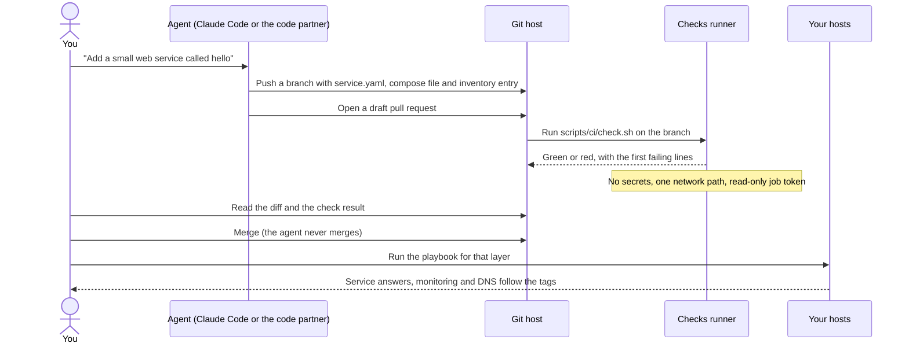

# Using it: an example from request to running service

Back to the [README](../../README.md). This page walks through one change from start to finish: adding a small service
called `hello`. It shows the two parts you will use most, the service particle and the pull request flow.

## The flow in one picture

Two rules hold at every step: the agent only proposes, and a person merges and applies.

## Worked example: `hello`

1. **Describe the service.** Copy [`services/_templates/service.example.yaml`](../../services/_templates/service.example.yaml)
   to `services/applications/hello/service.yaml`. Set the name, the port and the tags. The tags are the control plane: they
   decide whether the service is exposed, how it logs in and whether it is backed up.
   [How to add a service](../HOW_TO_ADD_SERVICE.md) explains each field and [the tag reference](../TAG_REFERENCE.md) lists the tags.
2. **Give it a host.** For a new VM, copy [`terraform/envs/example-vm`](../../terraform/envs/example-vm), fill in
   `terraform.tfvars` from the example and run `terraform init && terraform plan`. Read the plan before you apply it.
3. **Put it in the inventory.** Add the host and the service to
   [`ansible/inventory/services.yml`](../../ansible/inventory/services.yml). That one file is the source of truth for hosts and IPs.
4. **Run the checks locally.** `scripts/ci/check.sh` parses the YAML, Python and shell, runs `terraform fmt`, an Ansible syntax check,
   the offline tests and a secret scan. This is the same script the runner uses, so a red result here is a red result there.
5. **Open a pull request.** Fill in the template: what changed, what ran, known risks, what needs a human look. Wait for the checks.
6. **Merge, then apply.** After you merge, run the playbook for that layer from [`ansible/playbooks/`](../../ansible/playbooks). Each layer
   can be run again without disturbing what is already up.
7. **Verify against the live system.** Open the service, then check that monitoring sees it. A green pipeline proves the files are
   valid, not that the service works.

## When an agent does the work

You can hand steps 1 to 5 to an agent. Give it the request in words and let it propose. Then read the diff as you would any other
pull request. The rules it works under are in [agents and checks](AGENTS_AND_CHECKS.md).

## Standing the platform up

This page changes a running system. To build one from an empty host, with preflight and the layers in order, see [deploying from scratch](DEPLOY.md).

## What to expect

This is a working homelab shared as a reference. You will adapt paths, hostnames and versions to your own setup, and some roles
assume the layout described in [the philosophy](PHILOSOPHY.md). Treat it as a pattern to learn from and copy parts of.
